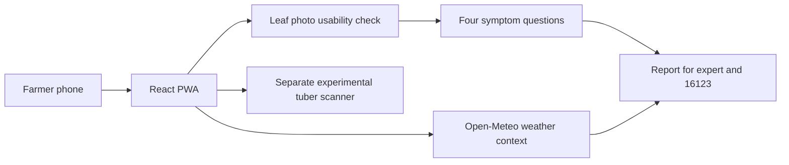

# AluSathi FieldWatch — Technical Documentation

## Purpose

AluSathi is a Bangla-first potato field app for Bangladesh farmers. It records leaf photos and symptoms for an expert report, provides weather context and a field diary, and offers a separate experimental harvested-potato scanner.

It is a screening and research system, not a confirmed diagnosis or pesticide-prescription system.

## Current runtime architecture



## Active components

| Layer | Implementation | Responsibility |
| --- | --- | --- |
| Interface | React 18, TypeScript, Vite | Bangla/English farmer journey |
| PWA | `vite-plugin-pwa` | Installable shell and weather caching |
| Leaf report | Browser UI | Records photos and farmer-observed symptoms; no disease label |
| Weather | Open-Meteo | Current temperature, humidity and precipitation context |
| Research API | FastAPI | Separate research inference boundary; not used by the farmer leaf report |
| Research model | MobileNetV3-Small, PyTorch | Three-class potato-leaf classifier kept outside public assets |
| Safety policy | Farmer UI | Do not claim a leaf-disease diagnosis from the unvalidated model |

The active application route is `/`. Legacy source files may remain in the repository, but they are not mounted by `src/App.tsx` and are outside the competition demo path.

## Farmer flow

1. Choose a one- or three-photo leaf report, or the separate harvested-potato scanner.
2. Photograph a leaf in daylight. Very small, dark, or plainly blurred images are rejected.
3. Answer four visual symptom questions; the app does not name a leaf disease.
4. Share the report with an agricultural expert or call 16123. Weather context is not a diagnosis.
5. The research leaf ONNX model is not shipped to the PWA and does not run in this farmer flow.

## Model state

- Training source: PlantVillage potato subset.
- Classes: early blight, healthy and late blight.
- Controlled test accuracy: 95.98% on 323 PlantVillage images.
- External regional accuracy: 51.19% on 13,800 unseen regional images.
- Field status: not approved.
- Default API behavior: fail closed to `unknown` until an approved replacement model is explicitly enabled.

See `competition/MODEL_CARD.md`, `competition/DATASET_CARD.md` and `PHASE1_EVALUATION.md` for evidence.

## Local operation

```powershell
npm install
npm run api
```

In another terminal:

```powershell
npm run dev
```

Open `http://127.0.0.1:8080/`.

## Verification

```powershell
.venv\Scripts\python.exe -m unittest tests.test_inference_policy tests.test_api_safety
npm run lint
npm run build
npm audit --omit=dev
```

## Deployment status

The React app has been deployed to Vercel previously. The separate Python API and optional account service require server configuration and are not implied by the static deployment.
